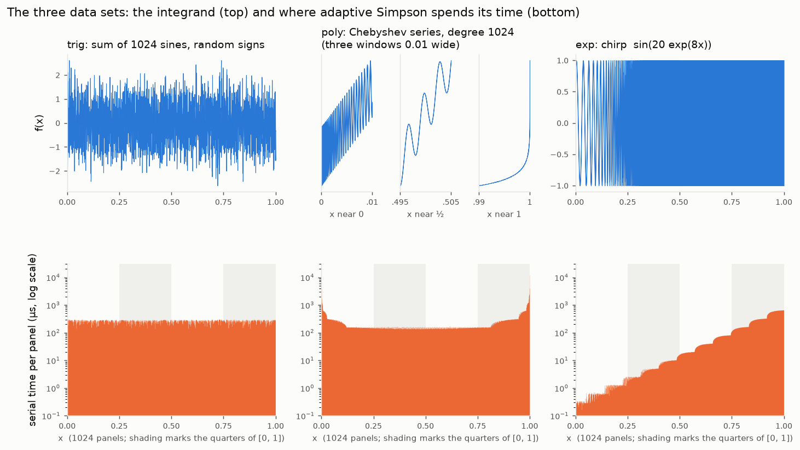

# Activity 4 — Load Balancing Adaptive Simpson Integration

## Background

Lectures 10–12 gave you two ways to say "do these things in parallel": a
**parallel loop** (`#pragma omp parallel for`, `cilk_for`) and **parallel
recursion** (`#pragma omp task`, `cilk_spawn`). Both hand work to threads, but
they decide *how much work each thread gets* in different ways. This activity
uses a computation whose work is uneven to show when that decision matters.

The computation is **adaptive Simpson integration**. Simpson's rule estimates
the integral of `f` over an interval `[a, b]` from three values of `f`:

```
simpson(a, b) = (b - a) / 6 * (f(a) + 4 f(m) + f(b)),    m = (a + b) / 2
```

Adaptive Simpson integration recurses into each region to refine the estimate
within a specified error. It integrates the two halves `[a, m]` and `[m, b]`.
If their sum agrees with the whole within the error, it accepts the interval.
If not, it splits and recurses on each half.

```cpp
static double adapt(double a, double b, double eps, double whole, ...)
{
    double m = (a + b) / 2;
    double left = simpson(a, m), right = simpson(m, b);
    if (std::fabs(left + right - whole) <= 15 * eps)
        return left + right;                         // smooth here: stop
    return adapt(a, m, eps / 2, left, ...) +         // wiggly here: split
           adapt(m, b, eps / 2, right, ...);
}
```

Where `f` is smooth the recursion stops early. Where `f` wiggles, the
recursion goes deep. **How much work it does depends on what `f` looks like
in each region.**

The harness integrates three functions over `[0, 1]`:

| Input | `f(x)` | What it looks like |
|---|---|---|
| `trig` | a sum of 1024 sines with random signs | the same wiggliness everywhere on `[0, 1]` |
| `poly` | a Chebyshev series of degree 1024 | gentle in the middle; wiggles packed tightly near `x = 0` and a steep rise at `x = 1` |
| `exp` | a chirp, `sin(20 exp(8x))` | the frequency grows like `exp(8x)`: calm near `0`, very fast near `1` |



The top row shows each function. The bottom row shows what it costs: the
serial time adaptive Simpson spends on each of the 1024 panels, measured on
an Apple M5. The bottom row uses a **log scale**, so each gridline up is ten
times more work.

* **`trig`** looks the same everywhere, and every panel costs about the same,
  150–300 µs.
* **`poly`** looks like a smooth curve at full scale, so the top panel zooms
  into three windows of the same width. Near `x = ½` the window holds three
  gentle wiggles. Near `x = 0` it holds dozens, packed tighter and tighter
  toward `x = 0`. Near `x = 1` the function shoots up. The panels at the two
  ends cost from ten to a hundred times as much as the panels in the middle.
* **`exp`** speeds up from left to right. The cost climbs in steps: each step
  is where the frequency has doubled, so the recursion goes one level deeper
  and the work per panel doubles. The last panels cost thousands of times
  more than the first.

The serial program does the same total work whatever order it takes the
panels in. A parallel program has to split that work among threads, and a
split that is even on `trig` may not be even on the other two.

There are two ways to run this in parallel, and you will write both.

1. **Loop over panels.** Cut `[0, 1]` into 1024 equal **panels** and
   integrate each one serially with `adapt`, each with 1/1024 of the error
   budget. The panels are independent, so this is a parallel loop with a sum.
2. **Parallel recursion.** Run the recursion itself in parallel: integrate
   the two halves of every split at the same time. Below a fixed depth
   (`SPAWN_DEPTH`, 12 by default) the recursion goes back to the serial
   `adapt`, so the tasks aren't too small to be worth creating.

## Grading and feedback

The assignment is worth **100 points: 72 autograded and 28 manually graded**.
Each of the six functions earns up to 12 automated points, in three independent
4-point groups. Every group checks numerical correctness with one worker and
repeated runs with multiple workers, and requires integration work to execute
on more than one thread in the multiworker runs. A serial implementation earns
zero automated points even if it computes the right integral. There are no
points just for compiling.

The grader calls your functions directly, substitutes additional integrands
for `f`, and varies tolerance, worker count (2–4), and `SPAWN_DEPTH`. Preserve
the function names, parameters, serial integration helpers, and harness.
You may add helper functions for a reducer. Do not hard-code the supplied
integrands, answers, four workers, or a recursion cutoff of 12. The grader also
calls each function repeatedly in one process; reset each sum on every call.
The grader uses OpenCilk 3.0, C++17, and `-O3` on Linux; the macOS QoS calls
are replaced by harmless compatibility definitions for grading.

Scores and concept-level test feedback are available as soon as grading
finishes. Compilation, crash, timeout, and serial-execution feedback are
reported separately. Passing these finite tests does not prove race freedom.
**No fixed speedup is required for automated credit.**

The remaining 28 points cover scheduling/grain/recursion choices (6), results,
plot and comparison (8), load-balancing reasoning (7), and grain-size reasoning
(7). Submit the written work and measurements even if all automated tests pass.

## Getting started

These files come with this assignment:

* [`simpson.M5.cpp`](simpson.M5.cpp) — the harness, with the integrands, the
  serial version and six parallel versions that are still serial. **You add
  OpenMP directives or Cilk keywords and functions to six marked places (`TODO (Part 1)`).**
* [`run.M5.sh`](run.M5.sh) — builds the program and runs every version on
  every input three times.
* [`plot_results.py`](plot_results.py) — plots the results.
* This handout.

This version of the activity runs on macOS on Apple silicon. macOS can't pin
a thread to a core. Instead, the harness has the main thread and every
OpenMP thread and Cilk worker request interactive QoS. This is a scheduling
preference, not a guarantee of a particular core.

**Install** OpenCilk in `~/opencilk` (from [opencilk.org](https://www.opencilk.org/)),
and Homebrew's OpenMP runtime and matplotlib:

```bash
brew install libomp
python3 -m venv ~/activity4-venv
source ~/activity4-venv/bin/activate
python3 -m pip install matplotlib
```

In each new terminal, run `source ~/activity4-venv/bin/activate` before
plotting results. This environment keeps activity packages separate from the
system Python installation.

**Build:**

```bash
~/opencilk/bin/clang++ -fopencilk -O3 -std=c++17 \
    -Xpreprocessor -fopenmp -I/opt/homebrew/opt/libomp/include \
    -L/opt/homebrew/opt/libomp/lib -lomp simpson.M5.cpp -o simpson.M5
```

**Run** one version on one input, with 4 threads:

```bash
OMP_NUM_THREADS=4 ./simpson.M5 omp_static exp
CILK_NWORKERS=4   ./simpson.M5 cilk_spawn exp
```

Each run times the serial version first, then the version you named, and
prints both, the speedup, and how far the parallel answer is from the serial
one:

```
omp_static   exp   eps 1e-12: serial   106.14 ms, parallel    92.86 ms, 4 threads, speedup  1.14x, rel. diff 1.2e-15
```

Run the starter before you change anything. Every version runs, gives the
right answer, and reports a speedup of about `1.00x`: it is still serial.

> **The relative difference should stay below about `1e-13`.** A parallel sum
> adds the same numbers in a different order, so the last digit or two can
> change. A larger difference, or a different answer on every run, means two
> threads are writing the same variable at once.

Close other CPU-heavy programs, keep the machine plugged in, and record your
Mac model, macOS version, and OpenCilk version with your results.

## Part 1 — Parallelize six functions (78 points: 72 automated, 6 manual)

Each function below has a `TODO (Part 1)` comment above it. Add OpenMP
directives or Cilk keywords to make it parallel, and make `sum` safe to update
in parallel. In the four loop versions, many threads add to `sum` at the same
time, so you will need to use features of OpenMP or Cilk to make those
concurrent updates safe. The intended changes are small; leave the integration
algorithm and harness alone. Equivalent thread-safe sums are accepted, including OpenMP
reductions, atomic updates, or critical sections and valid Cilk reducers.

| Version | Function | What to write |
|---|---|---|
| `omp_static` | `omp_static` | an OpenMP parallel loop over the panels, **static** schedule |
| `omp_dynamic` | `omp_dynamic` | the same loop with a **dynamic** schedule that hands out one panel at a time |
| `omp_task` | `adapt_omp` | make the left half an OpenMP **task**, compute the right half, and **wait** for the task before adding |
| `cilk_for` | `cilk_for_panels` | the loop over panels with `cilk_for` and Cilk's **default** grain size |
| `cilk_for_g1` | `cilk_for_grain1` | the same `cilk_for` with a grain size of **1** |
| `cilk_spawn` | `adapt_cilk` | **spawn** the left half, compute the right half, and **sync** before adding |

Notes:

* In `adapt_omp`, the task writes `l`, which is a local variable of the
  function that creates it. OpenMP tasks get a *private copy* of local
  variables by default. Make sure the task writes the `l` that the function
  adds up after the wait.
* `omp_task` already starts a team of threads (`#pragma omp parallel`) and
  has one of them begin the recursion (`#pragma omp single`). The other
  threads run the tasks it creates.

Test each version on all three inputs as you go, including with 1, 2, and 4
workers. Check that the answers agree with serial and investigate whether the
`trig` workload speeds up on your machine. Speedup is evidence to discuss,
not a universal threshold for earning credit. The 6 manual code points assess
the specified static/dynamic schedules, default/unit grains, and task/spawn
structure and cutoff; numerical tests alone cannot establish these choices.

## Part 2 — Measure and plot (8 points)

Run every version on every input, three times, then plot the results:

```bash
./run.M5.sh
python3 plot_results.py results.M5.txt speedup.M5.png "4 M5 performance cores"
```

`run.M5.sh` rebuilds `simpson.M5` from your `simpson.M5.cpp` first, and takes
a few minutes. The plot shows, for each input, the median speedup of each
version as a bar, with a black line from the slowest to the fastest of the
three runs.

Submit `speedup.M5.png` and `results.M5.txt` (5 points for complete,
consistent measurements and a labeled plot). Keep all 54 measurements: three
runs of six versions on each of three inputs.

**(a), 3 points.** Which input gives nearly the same speedup for all six versions? On
which input do the versions differ the most? Give the best and the worst
version on that input, with their speedups.

==
For trig, all six versions reach nearly the same speedup (between 3.53x and 3.60x). 
Each panel of trig costs about the same, so scheduling methods make no difference.

The versions differ most on exp: the best is `omp_task` at 3.55x; the worst is `omp_static` at 1.16x. 
`omp_static` gives thread 3 panels 768 - 1023, which hold almost all the work; the other three threads finish early and wait. 
`omp_task` instead creates tasks as it recurses, and idle threads take pending tasks; the expensive region is then shared among all.
==

## Part 3 — Static vs. dynamic scheduling (7 points)

The harness can show you how the work is spread across `[0, 1]`. The `skew`
mode times each of the 1024 panels serially, and prints how the work divides
among the four quarters of `[0, 1]`:

```bash
./simpson.M5 skew trig
./simpson.M5 skew poly
./simpson.M5 skew exp
```

**(b), 4 points.** With a static schedule and 4 threads, which panels does each thread
integrate? From the work in each quarter, what is the best speedup a static
schedule could reach on each input? How close does your measured `omp_static`
speedup come to it?

==
> Measured:
> trig: work by quarter: 25.02% 24.88% 25.15% 24.95%
> poly: work by quarter: 27.10% 15.23% 15.50% 42.17%
> exp:  work by quarter: 0.21%   1.55% 11.53% 86.71%

Thread 0 gets panels 0-255, thread 1 gets panels 256-511, and so on.

The largest quarter of the inputs decides the finish time, the largest quarter on the three inputs:
- trig holds 25.15% of the work, so the static can reach at most 1/0.2515 = 3.98x
- poly holds 42.17% of the work, so the static can reach at most 1/0.4217 = 2.37x
- exp holds 86.71% of the work, so the static can reach at most 1/0.8671 = 1.15x

The actual speed up (in results.M5.txt) are 
- trig: 3.54x-3.55x 
- poly: 2.26x
- exp : 1.15-1.17x
So for Poly and exp, the measured speedup nearly reach the limit. 
For trig, it is below 3.98x but the quarters are nearly equal. 

==

**(c), 3 points.** What properties of the data make dynamic scheduling improve
performance over static scheduling? Explain the expected differences among
the three inputs and compare with your measurements. Discuss any departures
from the expected trend.

==
Two properties are particularly important: (1) uneven cost per panel and (2) expensive panels are clustered in a few part of [0, 1]. 
Under static scheduling, the expensive cluster may land on one thread, while the dynamic scheduling allows each thread to handle different amount of panels and balance time cost.

The estimated (From ./simpson.M5 skew):
> skew         trig  eps 1e-08: serial   274.01 ms, integral -0.00791175435115306
>   per panel: min 143.3 us, median 278.4 us, max 315.3 us; costliest 1% of panels: 1% of the work
>   work by quarter of [0,1]: 25.00% 24.87% 25.17% 24.97%
> skew         poly  eps 1e-12: serial   252.57 ms, integral 0.866850512866918
>   per panel: min 138.0 us, median 159.4 us, max 12044.3 us; costliest 1% of panels: 13% of the work
>   work by quarter of [0,1]: 27.08% 15.21% 15.51% 42.20%
> skew         exp   eps 1e-12: serial   119.77 ms, integral 0.0028201732939432
>   per panel: min 0.2 us, median 19.3 us, max 782.9 us; costliest 1% of panels: 6% of the work
>   work by quarter of [0,1]: 0.21% 1.56% 11.53% 86.70%
If the biggest panels are smaller than the fair share in each inputs, they can be balanced via dynamic scheduling. 
Trig: (274.01ms / 4) = 68.5ms > 315.3 us; 
Poly: (252.57ms / 4) = 63.14ms > 12044.3us; 
Exp: (119.77ms / 4) = 29.94ms > 782.9us
So, all three inputs with dynamic scheduling can reach about 4x.

The measured results (from results.M5.txt): The gain of dynamic is
- trig: (3.55x to 3.56x) = 1.00x gain
- poly: (2.26x to 3.48x) = 1.54x gain
- exp:  (1.16x to 3.52x) = 3.03x gain
==

## Part 4 — Grain size (7 points)

A parallel loop splits its iterations into **chunks** (OpenMP) or **grains**
(Cilk). A chunk is the unit of scheduling: one thread runs a whole chunk,
start to finish, and a chunk is never split further.

**(d), 1 point.** What is OpenMP's default chunk size for `schedule(dynamic)` when you
don't give one? Does it depend on the number of iterations or threads?

==
The default chunk size for schedule(dynamic) is 1. It doesnt depend on the number of iterations or threads.

==

**(e), 2 points.** What is the default grain-size heuristic in your OpenCilk version? Cite
your compiler/runtime version and a documentation or implementation source.
Give the formula (and any rounding)
and its value for this loop (1024 panels) on 4 workers. How many grains does
the loop become, and what fraction of `[0, 1]` does each one cover?

==
The default grain size is 32.

> clang version 19.1.7 (https://github.com/OpenCilk/opencilk-project cd8ccfc1fd8293654dde7bf26657f08f89c7e54b)
> Implemented in `__cilkrts_cilk_for_grainsize_64 in the OpenCilk Cheetah runtime`, `runtime/cilk2c_inlined.c.`

The formula is:
> grainsize = max(1, min(2048, number of loop iterations 1024 / (8 * number of workers 4)))

Each grain covers 32/1024 = 1/32 (3.125%) of [0, 1].

==

**(f), 3 points.** Compare `cilk_for` and `cilk_for_g1` on your plot. Does a grain
size of 1 improve the uneven inputs on your machine? Explain the result,
including any differences from the expected trend. Reason about the data:
use the `skew` output to estimate how much of the work the costliest
grain holds under the default grain size, and what that does to the
other workers.

==
This is the results from results.M5.txt:
trig: `cilk_for` 3.53x vs. `cilk_for_g1` 3.56x --> similar
poly: `cilk_for` 2.72x vs. `cilk_for_g1` 3.20x --> improved but not perfectly improved
exp : `cilk_for` 3.02x vs. `cilk_for_g1` 3.51x --> improved
It improves poly and exp inputs

From (e)'s skew results
- For exp, The biggest 1% panel is 6% of the work out of total 119.77ms
- For poly, it fixs partially because its most expensive single panel takes 12ms, which is 5% of all the work. 
So if a thread picks up this big panel near the end, the other threads still need to wait, 
it cannot make it perfectly balanced

==

**(g), 1 point.** (d) and (e) are very different defaults for the same job. What does
each one assume about the iterations of a loop? Which assumption fits this
loop?

==
OpenMP (default 1 iteration) assumes iterations are expensive and costs may vary, so paying scheduling on everyone iteration is relatively cheaper.
Cilk assumes iterations are cheap and costs are similar. It groups the iterations to save the scheduling overhead. It also considers 32 is enough for thread to steal panels from each other.

OpenMP fits this loop because panels are expensive and uneven.

==

## What to submit

Upload the C++ file to the Gradescope programming assignment. Use
`simpson.M5.cpp` by preference; any uniquely identifiable `.cpp` filename is
accepted, including a file inside an uploaded folder. Upload only one solution.
The grader recognizes `simpson.M5.reference.cpp`, `simpson.M5.cpp`, and
`activity4_submission.cpp`, in that priority order, before falling back to a
unique `.cpp`; an exact root match wins within a recognized name. A filename
containing `reference` receives no special credit.

Submit measurements, plot, and a PDF with answers (a)–(g) and machine details
to the written-work submission. The code and manual components sum to 100.

* Your `simpson.M5.cpp`, with the six functions parallelized.
* `speedup.M5.png` and `results.M5.txt` from Part 2.
* Your answers to (a)–(g), and your machine details.
